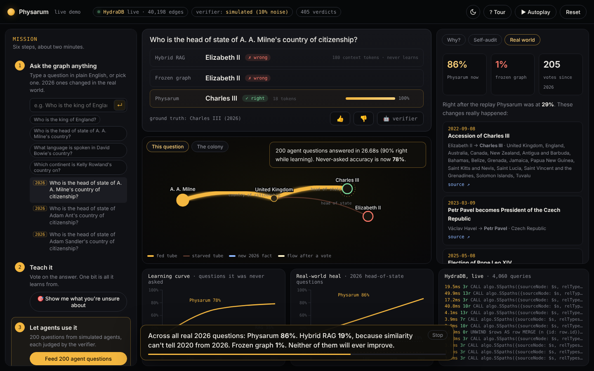

# Physarum: the knowledge graph that heals itself

**HydraDB Hackathon · Track 1: a graph that improves itself**

> Knowledge graphs go stale. Physarum turns every 👍/👎 on an agent's answer into slime-mould
> physics on HydraDB edges: paths that lead to right answers thicken, while hallucinated and
> outdated facts starve. Proven on what **really** changed in the world between 2020 and 2026.

**Live demo:** `https://<your-deployment>` · landing page `/` · interactive console `/demo` (first visit offers a 90-second autoplay or a guided tour) · **paste your own facts: `/try`**



## The result in one table

Real data: CoDEx (Wikidata), 2,034 entities and 40,198 edges, including **3,655 facts humans verified as false**.
Agents ask popular questions and a verifier judges each answer. Mean of 5 seeds; regenerate with `make numbers`.

| | Hybrid RAG (vector + keyword) | Frozen graph | Count-only learner | **Physarum** |
|---|---|---|---|---|
| Questions it was **never asked** | 37% | 32% | 86% | **85%** |
| Questions about other people (shared highways) | 24% | 38% | 89% | **87%** |
| After facts change, +250 / +1,000 / +2,500 questions | – | 45% / 45% / 45% | 38% / 46% / 58% | **59% / 76% / 87%** |
| **Real 2020 → 2026 heads of state** (339 questions) | 17% | 4% | 76% | **85%** |
| Context tokens per answer | 180 | – | – | **18** |
| Learns from use | no | no | yes | **yes** |

**Reading the table honestly:** on a graph where nothing changes, simple vote counting learns about as well as Physarum
(within a point or two). Physarum's edge is **when the world changes**, real or simulated, plus a much sharper self-audit.

**Why RAG loses:** a hallucinated or outdated fact is exactly as *similar* to the question as the true one. Even when hybrid RAG
retrieves the right person's facts (67% of the time), it picks the true one only 55% of the time; on the real 2026
changes it was 66% right in 2020 and drops to 17%, and it never recovers. RAG baseline: spaCy 300-d vectors + TF-IDF,
reciprocal rank fusion, top-10, a generous two-hop reader told which relation to follow. Set `PHYSARUM_EMBED=openai` to re-run with `text-embedding-3-small`.

On the live demo, running on real HydraDB, the real-world replay goes from about 29% to **81–85%** in 200 agent questions; the frozen graph stays at **1%**.

| Also measured | |
|---|---|
| Self-audit: facts it flags as no longer trustworthy | **80% precision** vs 25% chance (3.14× lift), recall 35% |
| Removal test: learned → wiped → restored | **86% → 27% → 86%** (exact restore from HydraDB) |
| Votes to heal a real change (median per country) | **5** (small sample: 2 countries needed healing in that run) |
| Cost per verdict | 1 read + 1 batched write, 2.6 edges touched |
| Cost of forgetting | **0 writes** (instead of 40,216 per step) |
| HydraDB latency (debug build, local) | read p50 20.9 ms / p95 60.2 ms · write p50 28.8 ms / p95 48.1 ms |

Full table: [NUMBERS.md](NUMBERS.md). Machine-readable: [`static/numbers.json`](static/numbers.json).

## Why now (demand evidence)

- 76% of 143 founders, operators and engineers in [Slite's 2026 survey](https://slite.com/learn/dangers-of-stale-documentation) had seen an AI tool answer wrongly from an outdated doc.
- [mem0ai/mem0 #4956](https://github.com/mem0ai/mem0/issues/4956): users of the most popular agent-memory library report old facts outranking new ones; the proposed fixes are unmerged.
- [Thoughtworks Technology Radar (Apr 2026)](https://www.thoughtworks.com/radar/platforms/graphiti) moved a temporal knowledge graph to *Trial* because flat vector stores can't track changing facts.
- Live usage of this deployment (visitors, graphs built from their own facts, verdicts, early-access requests, "would you use it?" answers) is public at `/api/traction`, counts only.

## Many judges at once: private sandboxes

The graph (CoDEx plus the real 2026 facts) lives in HydraDB and is shared; retrieval always runs natively with
`algo.SSpaths`. Each browser tab gets its **own sandbox**: private tube state, its own 2020 or 2026 world, its own
time-lapse and audit. One judge pressing *Reset* or jumping to 2026 never changes what another judge sees
(verified with concurrent sessions on HydraDB). `/demo?shared=1` opens the **shared colony**, whose learning is
written back to HydraDB edges and survives restarts.

## Contributing back to HydraDB

- [`docs/hydradb-issue-localfs.md`](docs/hydradb-issue-localfs.md): a reproducible bug report for the local-filesystem
  store failing on restart (`PutMode::Update not yet implemented`), with the cause and suggested fixes.
- [`docs/rfc-algo-physarum.md`](docs/rfc-algo-physarum.md): a proposal for a native `algo.physarumUpdate` procedure,
  so any HydraDB graph can learn from feedback atomically, without a client round trip.

## Try it on your own facts, no install

Open `/try`, paste `subject,relation,object` lines (or upload a CSV, up to 5,000 facts), ask a multi-hop question
and vote. The built-in example: Bob moved from Carol's team to Dana's, and both facts are still in the data.
Ask where Bob is based, vote 👎 once, and the answer heals to Berlin. "Which tool does Bob's team use?" is then
right without any vote, because it shares the healed edge, and the audit names `Bob reports_to Carol` as stale.

## Install anywhere

```bash
pip install physarum-graph                 # SDK + CLI (numpy, scipy only)
physarum example > facts.csv && physarum chat facts.csv   # ask, vote y/n, watch it heal, type 'audit'
```

**MCP: give any agent a self-healing graph of your facts** (Claude Desktop, Cursor, Claude Code, …)

```bash
pip install "physarum-graph[mcp]"
```

```json
{"mcpServers": {"physarum": {"command": "physarum-mcp", "args": ["--facts", "/path/facts.csv"]}}}
```

Tools: `relations`, `ask`, `feedback`, `add_fact`, `audit`. Add `--hydradb-url` so the learning persists on HydraDB edges.

**LangChain**

```python
from physarum.langchain import physarum_tools, PhysarumRetriever  # pip install "physarum-graph[langchain]"

agent_tools = physarum_tools(g)  # ask_graph · graph_feedback · graph_audit
```

## Use it on your own graph (3 lines)

```python
from physarum import Graph  # pip install physarum-graph   (or pip install -e . from this repo)

g = Graph.from_csv("facts.csv")  # subject,relation,object   · or hydradb_url="https://…"
a = g.ask("Bob", "reports_to", "leads")  # any number of hops
g.feedback(a, correct=False)  # one bit; the graph learns immediately
g.add("Bob", "reports_to", "Dana")  # append new facts live
g.audit()  # facts it stopped trusting
```

`python examples/quickstart.py` runs a tiny company graph where Bob changes teams: one 👎 and the graph re-routes, and a 3-hop question ("where is Bob based?") is right for free.

## What it does

1. **Learns from one bit.** A 👍/👎 on the final answer. Kirchhoff's laws decide which edges earned the credit.
2. **Heals when the world changes.** Plastic tubes re-weigh old evidence on every use, so a superseded fact is unlearned in a few votes. The demo writes the *real* changes (Elizabeth II → Charles III in 16 realms, Havel → Petr Pavel, John Paul II → Leo XIV) into the graph. The old facts stay, exactly like an append-only extraction pipeline.
3. **Audits its own facts.** Tubes that keep starving are facts the graph stopped trusting. It lists them, checked against human labels.
4. **Flags uncertainty.** When flow splits almost evenly between answers, the answer is marked *unsure*.
5. **Explains every answer.** The path, each tube's length L, diameter D, resistance r = L/D, and every vote that shaped it.
6. **Forgets for free.** Evaporation is one global scale factor. It costs zero database writes.
7. **Blames the right edge.** On a 👎, the edge where the wrong path parts ways with the runner-up takes the blame, and shared prefix edges take none. This raised audit precision from 68% to 80%.
8. **Ask anything.** Plain-English questions are parsed onto the graph with no LLM ("Who is the king of England?").
9. **Time-lapse.** Replay how the colony grew highways and starved false facts.
10. **Graph health report.** One click exports the facts to review as Markdown.

## How it works

```
question ─► HydraDB  CALL algo.SSpaths({sourceNode, relTypes, weightProp: 'r'})      one native read
                │  candidate paths ranked by learned resistance r = L / D
                ▼
            answer (+ confidence from the flow split) ─► 👍/👎 (user, agent via MCP, or LLM judge)
                                                          │
   right: food at the answer → Kirchhoff flow → R += h·|Q|   (tubes thicken)
   wrong: light on the path → rej += 1, R *= γ               (tubes retract)
                                                          │
            UNWIND $rows … MERGE (s)-[r:REL {id}]->(d) SET r.R, r.acc, r.rej, r.r     one batched write
```

Tube length `L = 1 + 8·(rej+½)/(acc+rej+1)` is evidence that the terrain is hostile (Tero modelled mountains with light).
Diameter `D = 1 + R` is grown by flux. Use-dependent plasticity (γ = 0.5) discounts old evidence every time an edge is used.

## Why HydraDB

| Capability | HydraDB feature | Without it |
|---|---|---|
| Rank by what the graph learned | `algo.SSpaths` with `weightProp: 'r'` | Pull every path to the client and sort there |
| Learn in one round trip | Batched `UNWIND … MERGE … SET` | One write per edge per verdict |
| Shared, durable learning | Graph on object storage | Per-process memory, lost on restart, not shared across agents |
| Append new facts live | Typed edges, `MERGE` by id | Rebuild an index |

Verified against HydraDB compiled from [`hydra-db/hydradb`](https://github.com/hydra-db/hydradb): 200/200 identical candidate paths to the reference store, and an identical learning curve at every checkpoint.

**A finding for the HydraDB team:** after a restart, the `LocalFileSystem` object store rejects writes (`put_opts with PutMode::Update not yet implemented`). S3-compatible storage is unaffected. A fresh local store works.

## Real AI judge for free

Without a key, a simulated judge stands in for user 👍/👎 (wrong 10% of the time on purpose). Set **one** of these
to have an LLM check every fact on each answer's path instead:

| Env var | Cost | Default model |
|---|---|---|
| `GROQ_API_KEY` | free tier | `llama-3.3-70b-versatile` |
| `GEMINI_API_KEY` | free tier | `gemini-2.5-flash` |
| `ANTHROPIC_API_KEY` / `OPENAI_API_KEY` | paid | `claude-haiku-4-5` / `gpt-4o-mini` |

`PHYSARUM_JUDGE_MODEL` overrides the model. Free tiers allow a few requests per minute, so votes you ask for are
judged live, while fast agent traffic uses judgements already made and queues new facts for background checking.
The badge shows how many facts were checked and what share of verdicts came from the AI.

## Run it

```bash
pip install -r requirements.txt
make run-memory                      # no database: in-memory reference store, same semantics
HYDRADB_URL=… HYDRADB_AUTH_TOKEN=… make run   # against HydraDB (loads the graph on first start, ~30 s)
make test                            # 13 tests
make numbers                         # regenerate every number (≈1 min); add -hydradb for latency
make wikidata                        # refresh the real 2020→2026 changes from live Wikidata
```

Optional: set `ANTHROPIC_API_KEY` or `OPENAI_API_KEY` and the verifier becomes a **real LLM judge** that checks each fact on the answer's path (cached in `data/verdict_cache.json`). `make numbers` then also measures the judge's error rate against CoDEx's human labels.

**Deploy on Railway**
1. Add HydraDB from the Railway template ("HydraDB Graph Database on Object Storage").
2. Add this repo as a service (it uses `Dockerfile` and `railway.json`), and set `HYDRADB_URL` and `HYDRADB_AUTH_TOKEN`.
3. Open the service URL. The badge shows "HydraDB live". If HydraDB is unreachable, the app falls back to the in-memory store and says so.

**Agents (MCP):** `PHYSARUM_URL=https://<deployment> python mcp_server.py` exposes `ask`, `feedback`, `why` and `audit`, so agents learn the graph by using it.

## Where we lose (honest)

- **Picking questions by uncertainty didn't speed up learning** (73% vs 78% for random questions after 400 votes). We keep the *unsure* flag as a warning to users, and claim nothing more.
- **Audit precision is 80%, recall 35%.** It flags only what traffic has exposed, and a true fact on a wrong path still sometimes takes partial blame.
- **Divergence blame is a trade-off.** It improved the audit (68% → 80%) and the real-world heal (81% → 85%), but recovery after simulated changes dropped a few points (64/80/89% → 59/76/87%).
- **On a static graph, vote counting is as good.** Physarum only pulls ahead when facts change.
- **Rarely asked facts learn slowly.** No traffic means no evidence.
- **Benchmarks use two-hop questions.** The engine and SDK handle any number of hops; the benchmark uses 2,929 CoDEx questions plus 339 real head-of-state questions. The plain-English parser is keyword-based, so it only knows the entities and relations in this graph.
- **The verifier is simulated (90% accurate) unless an LLM key is set.** The learning itself is never simulated.
- **Real-change QIDs.** Names and dates of the 2026 changes are from the cited sources; `make wikidata` regenerates them, QIDs included, from live Wikidata.

## Layout

```
app.py                 HTTP routes: API + landing (/) + live demo (/demo)
physarum/service.py    demo state: graph, learner, baselines, timeline
physarum/engine.py     Physarum dynamics (Kirchhoff flow, plastic tubes, lazy evaporation)
physarum/store.py      HydraStore (native algo.SSpaths + batched writes) and MemoryStore (reference)
physarum/replay.py     real 2020→2026 changes, written append-only
physarum/audit.py      self-audit
physarum/verifier.py   simulated verifier and LLM judge
physarum/vector_rag.py hybrid RAG baseline (vector + keyword, RRF)
physarum/sdk.py        Graph SDK: from_csv / ask / feedback / add / audit
physarum/nl.py         plain-English questions → graph questions
examples/              bring-your-own-graph quickstart
mcp_server.py          MCP tools for agents
scripts/               make_numbers.py, fetch_wikidata_changes.py
static/                landing page (live slime-mould simulation), demo console, numbers.json
tests/                 pytest
```

## References

Tero et al., *Rules for biologically inspired adaptive network design*, Science 327 (2010) ·
Tero, Kobayashi & Nakagaki, J. Theor. Biol. (2007) · Bonifaci, Mehlhorn & Varma, *Physarum can compute shortest paths*, SODA 2012 ·
Becchetti et al., ICALP 2013 · Straszak & Vishnoi (2016) · Jones, *Characteristics of pattern formation and evolution in approximations of Physarum transport networks*, Artificial Life (2010) ·
Safavi & Koutra, *CoDEx*, EMNLP 2020.
