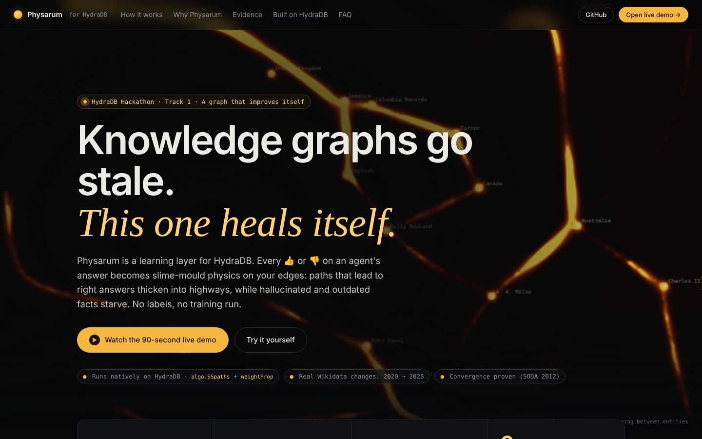
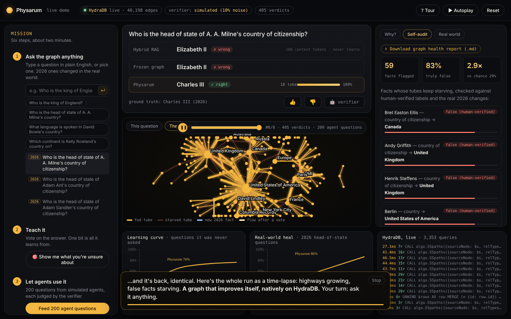

<div align="center">

# 🟡 Physarum

### Knowledge graphs go stale. This one heals itself.

**A learning layer for knowledge graphs, inspired by slime mould.** Every 👍/👎 on an agent's answer flows through the graph like nutrients through *Physarum polycephalum*: paths that lead to right answers thicken into highways, while hallucinated and outdated facts starve. No labels, no retraining, no re-indexing.

[](https://github.com/Gurleen12star/physarum/actions/workflows/ci.yml)
[](LICENSE)
[](pyproject.toml)
[](#-give-it-to-your-agents)
[](#-built-on-hydradb)

**[▶ Watch the 90-second demo](https://YOUR-DEPLOYMENT/demo?autoplay=1)** · **[Try it on your own facts](https://YOUR-DEPLOYMENT/try)** · **[For judges](#-for-judges-see-it-in-3-steps)** · **[Results](#-results)** · **[Quickstart](#-quickstart)** · **[Deploy](#-deploy)**

<sub>HydraDB Hackathon · Track 1: a graph that improves itself</sub>



</div>

---

## 👩‍⚖️ For judges: see it in 3 steps

No install and no sign-up. Every browser tab gets its **own private sandbox**, so nothing you do changes what another judge sees.

| Step | Where to click | What you'll see | Time |
|:---:|---|---|:---:|
| **1. ▶ Watch** | Landing page → **"Watch the 90-second live demo"**<br>or go straight to [`/demo?autoplay=1`](https://YOUR-DEPLOYMENT/demo?autoplay=1) | The whole story plays by itself: the graph answers *Elizabeth II*, jumps to the real world of 2026, agents vote, tubes thicken, and it heals to *Charles III* while RAG and the frozen graph stay wrong. | 90 s |
| **2. ? Understand** | In the demo, click **"? Tour"** (top right).<br>First-time visitors also get a welcome card offering **Watch it** or **Guided tour**. | An 11-stop walkthrough that highlights each panel: asking in plain English, the three readers side by side (RAG, frozen graph, Physarum), voting, the tube map, agent traffic, jumping to 2026, *Why?* / self-audit / real world, the time-lapse, the wipe-and-restore proof, and the live HydraDB query log. Use ← → or Esc. | ~2 min |
| **3. ✍️ Try your own** | Landing page → **"Try it on your graph"**<br>or go to [`/try`](https://YOUR-DEPLOYMENT/try) | Paste `subject,relation,object` lines (or upload a CSV, up to 5,000 facts), or click the built-in example. Ask a question, vote 👎 once, and watch the answer heal. | 1 min |

> 💡 **The 30-second wow moment** (in `/try` with the example): ask where **Bob** is based → *London* (unsure, 50/50). Vote 👎 once → *Berlin*, 97% confident. Then ask "Which tool does Bob's team use?" It's right **with no vote at all**, because it shares the healed edge. Open the audit: `Bob reports_to Carol` is flagged as stale.

You can also click **Autoplay** or **Reset** at any time in the demo's top bar, or open the **Shared colony** (`/demo?shared=1`), whose learning persists in HydraDB.

---

## The problem, in one example

In September 2022, Elizabeth II died. Every knowledge graph that said *"head of state of Canada → Elizabeth II"* became wrong overnight, and nothing told them so.

Vector RAG can't fix this: the outdated fact is **exactly as similar** to the question as the true one. Re-indexing can't fix it either: real extraction pipelines are append-only, so the old fact and the new one both sit in the graph.

**Physarum learns which facts to trust from how people use them.** We replayed what *really* changed in the world between 2020 and 2026 (339 head-of-state questions across 16 realms, the Czech Republic and the Holy See):

<div align="center">

| Frozen graph | Hybrid RAG (vector + keyword) | **Physarum** |
|:---:|:---:|:---:|
| **4%** | **17%** | **85%** |
| never improves | never improves | after a few hundred judged answers |

</div>

---

## 📊 Results

Real data: **CoDEx** (Wikidata), 2,034 entities and 40,198 edges, including **3,655 facts humans verified as false**. Agents ask popular questions and a verifier judges each answer. Mean of 5 seeds. Regenerate every number with `make numbers`.

| | Hybrid RAG | Frozen graph | Count-only learner | **Physarum** |
|---|:---:|:---:|:---:|:---:|
| Questions it was **never asked** | 37% | 32% | 86% | **85%** |
| Questions about other people (shared highways) | 24% | 38% | 89% | **87%** |
| After facts change: +250 / +1,000 / +2,500 questions | – | 45 / 45 / 45% | 38 / 46 / 58% | **59 / 76 / 87%** |
| **Real 2020 → 2026 heads of state** (339 questions) | 17% | 4% | 76% | **85%** |
| Context tokens per answer | 180 | – | – | **18** |
| Learns from use | ✗ | ✗ | ✓ | **✓** |

> **Reading this honestly:** on a graph where nothing changes, simple vote counting learns about as well as Physarum (within a point or two). **Physarum wins when the world changes**, in real or simulated data, and it can also tell you which facts it stopped trusting.

<details>
<summary><b>Why RAG loses, and how the baseline was built</b></summary>

<br>

A hallucinated or outdated fact is exactly as *similar* to the question as the true one. Even when hybrid RAG retrieves the right person's facts (67% of the time), it picks the true one only 55% of the time. On the real 2026 changes it was 66% right in 2020 and drops to 17%, and it never recovers.

Baseline: spaCy 300-d vectors + TF-IDF, reciprocal rank fusion, top-10, and a generous two-hop reader that is told which relation to follow. Set `PHYSARUM_EMBED=openai` to re-run it with `text-embedding-3-small`.

</details>

| Also measured | |
|---|---|
| 🔍 **Self-audit:** facts it flags as no longer trustworthy | **80% precision** vs 25% chance (3.14× lift), recall 35% |
| ♻️ **Removal test:** learned → wiped → restored | **86% → 27% → 86%** (exact restore from HydraDB) |
| 🩹 **Votes to heal a real change** (median per country) | **5** (small sample: 2 countries needed healing in that run) |
| ⚡ **Cost per verdict** | 1 read + 1 batched write, 2.6 edges touched |
| 🧹 **Cost of forgetting** | **0 writes** (instead of 40,216 per step) |
| ⏱️ **HydraDB latency** (debug build, local) | read p50 20.9 ms / p95 60.2 ms · write p50 28.8 ms / p95 48.1 ms |

On the live demo, running on real HydraDB, the real-world replay goes from about 29% to **81–85%** in 200 agent questions, while the frozen graph stays at **1%**.

Full table: [NUMBERS.md](NUMBERS.md) · machine-readable: [`static/numbers.json`](static/numbers.json)


---

## 🚀 Quickstart

**Run the full demo locally** (about 2 minutes, no database needed):

```bash
git clone https://github.com/Gurleen12star/physarum.git && cd physarum
python3 -m venv .venv && source .venv/bin/activate
pip install -r requirements.txt
make run-memory
```

Then open:

| URL | What you'll see |
|---|---|
| [localhost:8000](http://localhost:8000) | Landing page with a live slime-mould simulation |
| [localhost:8000/demo](http://localhost:8000/demo) | The console. First visit offers a **90-second autoplay** or a guided tour |
| [localhost:8000/try](http://localhost:8000/try) | **Paste your own facts** and watch them heal |

> 💡 **Try this:** in `/try`, load the example. Bob moved from Carol's team to Dana's, and *both* facts are still in the data. Ask where Bob is based, vote 👎 once, and the answer heals to Berlin. Then ask "Which tool does Bob's team use?" It's right **without any vote**, because it shares the healed edge. The self-audit names `Bob reports_to Carol` as stale.

**Or with Docker + HydraDB, in one command:**

```bash
docker compose up        # → http://localhost:8000
```

---

## 🧠 How it works

```
question ─► HydraDB  CALL algo.SSpaths({sourceNode, relTypes, weightProp: 'r'})      one native read
                │  candidate paths ranked by learned resistance r = L / D
                ▼
            answer (+ confidence from the flow split) ─► 👍/👎 (user, agent via MCP, or LLM judge)
                                                          │
   right: food at the answer → Kirchhoff flow → R += h·|Q|   (tubes thicken)
   wrong: light on the path → rej += 1, R *= γ               (tubes retract)
```

Each fact is a **tube** with a length *L* and a diameter *D*. Retrieval follows the path of least resistance *r = L / D*. A single bit of feedback on the final answer is enough: **Kirchhoff's laws** decide which edges on the path earned the credit, the same way *Physarum* decides which tubes to grow. The dynamics come from Tero et al. (*Science*, 2010), and convergence to shortest paths is proven (Bonifaci, Mehlhorn & Varma, SODA 2012).



### What it does

| | |
|---|---|
| 🎯 **Learns from one bit** | A 👍/👎 on the final answer. Kirchhoff flow assigns the credit. |
| 🩹 **Heals when the world changes** | Plastic tubes re-weigh old evidence on every use, so a superseded fact is unlearned in a few votes. Old facts stay in the graph, as they would in an append-only pipeline. |
| 🔍 **Audits itself** | Tubes that keep starving are facts the graph stopped trusting. It lists them, checked against human labels. |
| ⚖️ **Blames the right edge** | On a 👎, the edge where the wrong path splits from the runner-up takes the blame, and shared prefix edges take none. This raised audit precision from 68% to 80%. |
| 🤔 **Flags uncertainty** | When flow splits almost evenly between answers, the answer is marked *unsure*. |
| 💬 **Explains every answer** | The path, each tube's *L*, *D* and *r*, and every vote that shaped it. |
| 🧹 **Forgets for free** | Evaporation is one global scale factor: zero database writes. |
| 🗣️ **Plain-English questions** | "Who is the king of England?" is parsed onto the graph with no LLM. |
| 🎞️ **Time-lapse + health report** | Replay how the colony grew, and export the facts to review as Markdown. |
| 👥 **Private sandboxes** | Each browser tab gets its own tube state and its own 2020 or 2026 world. `/demo?shared=1` opens the shared colony, which persists in HydraDB. |

---

## 🧩 Use it on your own graph

```bash
pip install "physarum-graph @ git+https://github.com/Gurleen12star/physarum.git"
```

**Python SDK** (depends only on numpy and scipy):

```python
from physarum import Graph

g = Graph.from_csv("facts.csv")            # subject,relation,object  · or hydradb_url="https://…"
a = g.ask("Bob", "reports_to", "leads")    # any number of hops
g.feedback(a, correct=False)               # one bit; the graph learns immediately
g.add("Bob", "reports_to", "Dana")         # append new facts live
g.audit()                                  # facts it stopped trusting
```

**CLI:** ask, vote and watch it heal in your terminal:

```bash
physarum example > facts.csv && physarum chat facts.csv    # type 'audit' at any time
```

`python examples/quickstart.py` runs a tiny company graph where Bob changes teams: one 👎 and the graph re-routes, and a 3-hop question ("where is Bob based?") becomes right for free.

### 🤖 Give it to your agents

**MCP** (Claude Desktop, Cursor, Claude Code, and other MCP clients):

```bash
pip install "physarum-graph[mcp] @ git+https://github.com/Gurleen12star/physarum.git"
```

```json
{ "mcpServers": { "physarum": { "command": "physarum-mcp", "args": ["--facts", "/path/facts.csv"] } } }
```

Tools: `relations`, `ask`, `feedback`, `add_fact`, `audit`. Add `--hydradb-url` to persist the learning on HydraDB edges. To point agents at a deployed instance instead: `PHYSARUM_URL=https://<deployment> python mcp_server.py`.

**LangChain:**

```python
from physarum.langchain import physarum_tools, PhysarumRetriever   # extra: [langchain]

agent_tools = physarum_tools(g)   # ask_graph · graph_feedback · graph_audit
```

### 🧑‍⚖️ Use a real AI judge (free options available)

Without an API key, a simulated judge stands in for user votes, and it is **deliberately wrong 10% of the time**. Set **one** of these to have an LLM check every fact on each answer's path instead:

| Env var | Cost | Default model |
|---|---|---|
| `GROQ_API_KEY` | free tier | `llama-3.3-70b-versatile` |
| `GEMINI_API_KEY` | free tier | `gemini-2.5-flash` |
| `ANTHROPIC_API_KEY` | paid | `claude-haiku-4-5` |
| `OPENAI_API_KEY` | paid | `gpt-4o-mini` (`OPENAI_BASE_URL` for any compatible API) |

`PHYSARUM_JUDGE_MODEL` overrides the model. Verdicts are cached in `data/verdict_cache.json`. Free tiers allow only a few requests per minute, so votes you ask for are judged live, while fast agent traffic reuses earlier verdicts and queues new facts for background checking. With a key set, `make numbers` also measures the judge's error rate against CoDEx's human labels.

---

## ☁️ Deploy

The repo ships with a `Dockerfile`, `railway.json` (with a health check on `/api/health`) and `docker-compose.yml`.

**Tested before release:** the production image was built for `linux/amd64` (the same as Railway, Render and Fly) and run with no database. It became healthy in about 10 s. Every page plus the full judge flow (autoplay, ask, vote, feed agents, jump to 2026, audit, `/try`) worked with no errors, and memory settled at **about 485 MB**.

**Before you deploy, check:**
- [ ] Plan with **≥ 1 GB RAM** (the app uses about 485 MB; a 512 MB free tier will run out of memory and restart).
- [ ] **Exactly 1 replica / instance.** Judges' sandboxes live in the server's memory, so with 2+ replicas a judge's clicks could reach a different copy and their progress would appear to reset.
- [ ] `PHYSARUM_STORE=memory` set, unless you're connecting HydraDB. Without it the app still falls back to memory, but only after trying to reach HydraDB first.
- [ ] Optional: a free `GROQ_API_KEY` for a real AI judge.

### Option A: Railway (recommended, about 5 minutes)

1. Go to [railway.com](https://railway.com) → **New Project** → **Deploy from GitHub repo** → pick `physarum`. Railway detects `railway.json` and builds the `Dockerfile`.
2. In the service's **Variables** tab, choose a storage mode:
   - **No database (simplest):** `PHYSARUM_STORE=memory`
   - **With HydraDB (learning persists across restarts):** add HydraDB to the project from the Railway template *"HydraDB Graph Database on Object Storage"*, then set `HYDRADB_URL` and `HYDRADB_AUTH_TOKEN`. The graph loads on first start (about 30 s).
3. Optional: add a judge key such as `GROQ_API_KEY` (free).
4. **Settings → Networking → Generate Domain.** Open it. The badge shows *HydraDB live* or the in-memory store. If HydraDB is unreachable, the app falls back to memory and says so.

### Option B: Render or Fly.io (any Docker host)

- **Render:** New → **Web Service** → connect the repo → Runtime **Docker** → instance with ≥ 1 GB → add `PHYSARUM_STORE=memory` → health check path `/api/health`. Render sets `PORT`, and the image respects it.
- **Fly.io:** `fly launch` (it detects the Dockerfile; set the internal port to `8000`) → `fly secrets set PHYSARUM_STORE=memory` → `fly scale memory 1024` → `fly deploy`.

### Option C: Your own server

```bash
docker compose up -d      # app + HydraDB, data in a named volume
```

Change `HYDRADB_AUTH_TOKEN` from its development default before exposing it to the internet.

### If something goes wrong

| Symptom | Cause | Fix |
|---|---|---|
| Deploy keeps restarting / "Out of memory" / exit code 137 | Instance has < 1 GB RAM | Raise the memory limit to 1 GB |
| Health check failed | App bound to the wrong port | Don't set `PORT` yourself: the platform sets it and the image listens on it. On Fly, set `internal_port = 8000` |
| A judge's progress resets randomly | More than one replica | Scale to exactly 1 instance |
| Badge says *in-memory* though HydraDB was added | `HYDRADB_URL` unreachable or wrong token | Use the HydraDB service's **private** URL and the same `HYDRADB_AUTH_TOKEN`; check the app logs for the `[physarum]` line |
| HydraDB fails after a restart (`PutMode::Update not yet implemented`) | Known HydraDB local-filesystem bug ([report](docs/hydradb-issue-localfs.md)) | Use S3-compatible storage (as the Railway template does), or `PHYSARUM_STORE=memory` |
| Waitlist / feedback counts reset after a redeploy | Container disk is wiped on each deploy | Attach a volume and set `PHYSARUM_DATA_DIR` to its mount path |
| AI judge seems slow | Free-tier rate limits | Expected: live votes are judged first, and agent traffic reuses cached verdicts |

### After deploying

Open `https://<your-url>/api/health`. You should see `{"ok":true,"store":"memory",…}` (or `"store":"hydradb"`). Then open the landing page in a **private window**, so you see the first-visit welcome card exactly as a judge will.

Put your live URL into the README, `pyproject.toml`, `server.json` and the landing page in one go:

```bash
python scripts/set_links.py --github Gurleen12star --url https://your-app.up.railway.app
```

| Env var | Purpose |
|---|---|
| `PHYSARUM_STORE=memory` | Use the in-memory store instead of HydraDB |
| `HYDRADB_URL`, `HYDRADB_AUTH_TOKEN` | HydraDB connection (also `HYDRADB_GRAPH`, `HYDRADB_CELL`, `HYDRADB_NAMESPACE`) |
| `GROQ_API_KEY` / `GEMINI_API_KEY` / `ANTHROPIC_API_KEY` / `OPENAI_API_KEY` | Enable the LLM judge |
| `PHYSARUM_JUDGE_MODEL`, `PHYSARUM_NOISE` | Judge model override · simulated judge's error rate (default 0.1) |
| `PHYSARUM_DATA_DIR` | Where waitlist, feedback and traction data are written (mount a volume to keep it) |
| `PHYSARUM_EMBED=openai` | Use OpenAI embeddings for the RAG baseline |

---

## 🗄️ Built on HydraDB

- Retrieval always runs **natively** with `algo.SSpaths` and `weightProp: 'r'`: one read per question, one batched write per verdict.
- The graph (CoDEx plus the real 2026 facts) is shared, and each visitor's learning is sandboxed. Concurrent sessions on HydraDB were checked not to interfere.
- **Contributions back to HydraDB:**
  - [`docs/hydradb-issue-localfs.md`](docs/hydradb-issue-localfs.md): a reproducible bug report for the local-filesystem store failing on restart (`PutMode::Update not yet implemented`), with the cause and suggested fixes. S3-compatible storage is unaffected.
  - [`docs/rfc-algo-physarum.md`](docs/rfc-algo-physarum.md): a proposal for a native `algo.physarumUpdate` procedure, so any HydraDB graph can learn from feedback atomically, with no client round trip.

## 📈 Why now

- 76% of 143 founders, operators and engineers in [Slite's 2026 survey](https://slite.com/learn/dangers-of-stale-documentation) had seen an AI tool answer wrongly from an outdated doc.
- [mem0ai/mem0 #4956](https://github.com/mem0ai/mem0/issues/4956): users of the most popular agent-memory library report old facts outranking new ones. The proposed fixes are unmerged.
- The [Thoughtworks Technology Radar (Apr 2026)](https://www.thoughtworks.com/radar/platforms/graphiti) moved a temporal knowledge graph to *Trial* because flat vector stores can't track changing facts.
- Live usage of a deployment (counts only) is public at `/api/traction`.

---

## ⚖️ Where it loses (honest)

- **On a static graph, vote counting is just as good.** Physarum only pulls ahead when facts change.
- **Audit precision is 80%, but recall is 35%.** It flags only what traffic has exposed, and a true fact on a wrong path still sometimes takes partial blame.
- **Divergence blame is a trade-off.** It improved the audit (68% → 80%) and the real-world heal (81% → 85%), but recovery after simulated changes dropped a few points (64/80/89% → 59/76/87%).
- **Choosing questions by uncertainty didn't speed up learning** (73% vs 78% for random questions after 400 votes). The *unsure* flag is kept as a warning to users, and nothing more is claimed for it.
- **Rarely asked facts learn slowly.** No traffic means no evidence.
- **Benchmarks use two-hop questions** (2,929 CoDEx questions plus 339 real head-of-state questions). The engine and SDK handle any number of hops. The plain-English parser is keyword-based, so it only knows the entities and relations in this graph.
- **The verifier is simulated (90% accurate) unless an LLM key is set.** The learning itself is never simulated.
- **Real-change QIDs:** names and dates of the 2026 changes come from the cited sources. `make wikidata` regenerates them, QIDs included, from live Wikidata.

---

## 🛠️ Development

```bash
make run-memory        # app with the in-memory reference store (same semantics as HydraDB)
make run               # app against HydraDB (HYDRADB_URL, HYDRADB_AUTH_TOKEN)
make test              # pytest suite
make numbers           # regenerate every number (≈1 min); make numbers-hydradb adds latency
make wikidata          # refresh the real 2020 → 2026 changes from live Wikidata
make mcp               # MCP server against a deployment
```

<details>
<summary><b>Project layout</b></summary>

```
app.py                 HTTP routes: API + landing (/) + live demo (/demo) + /try
physarum/engine.py     Physarum dynamics (Kirchhoff flow, plastic tubes, lazy evaporation)
physarum/store.py      HydraStore (native algo.SSpaths + batched writes) and MemoryStore (reference)
physarum/service.py    demo state: graph, learner, baselines, timeline
physarum/replay.py     real 2020 → 2026 changes, written append-only
physarum/audit.py      self-audit
physarum/verifier.py   simulated verifier and LLM judge
physarum/vector_rag.py hybrid RAG baseline (vector + keyword, RRF)
physarum/sdk.py        Graph SDK: from_csv / ask / feedback / add / audit
physarum/nl.py         plain-English questions → graph questions
physarum/cli.py        `physarum` CLI      physarum/mcp_local.py   `physarum-mcp` server
mcp_server.py          MCP tools for agents (against a deployment)
examples/              bring-your-own-graph quickstart
scripts/               make_numbers.py, fetch_wikidata_changes.py, set_links.py
static/                landing page (live slime-mould simulation), demo console, numbers.json
tests/                 pytest
```

</details>

## 📚 References

Tero et al., *Rules for biologically inspired adaptive network design*, Science 327 (2010) ·
Tero, Kobayashi & Nakagaki, J. Theor. Biol. (2007) ·
Bonifaci, Mehlhorn & Varma, *Physarum can compute shortest paths*, SODA 2012 ·
Becchetti et al., ICALP 2013 · Straszak & Vishnoi (2016) ·
Jones, *Characteristics of pattern formation and evolution in approximations of Physarum transport networks*, Artificial Life (2010) ·
Safavi & Koutra, *CoDEx*, EMNLP 2020.

## License

[MIT](LICENSE)
